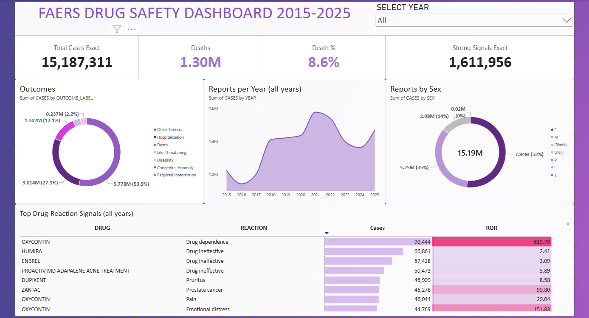
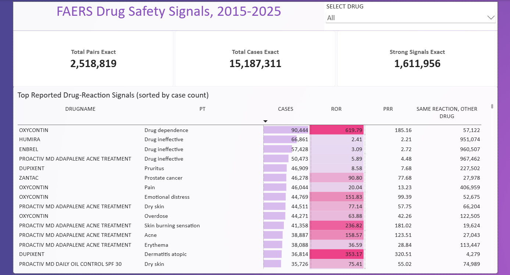
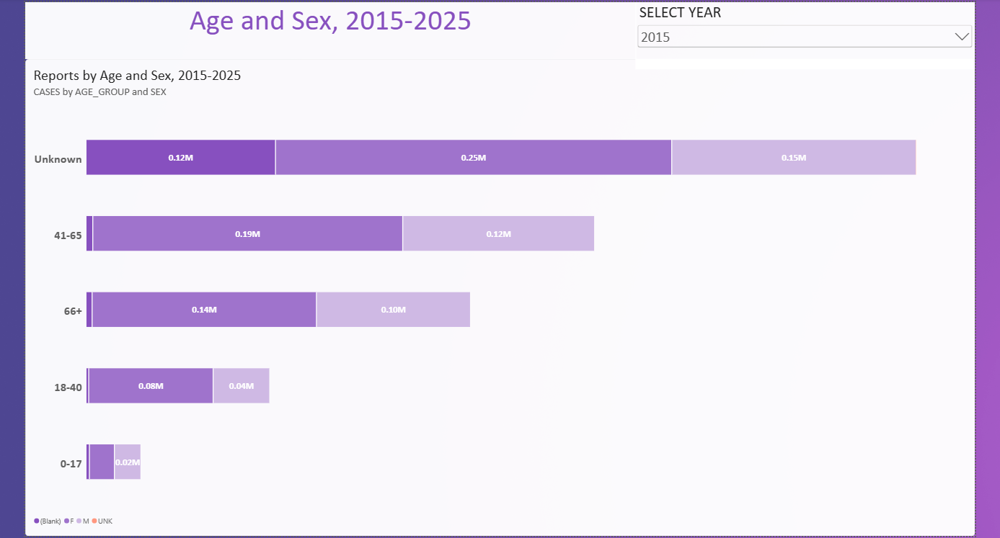
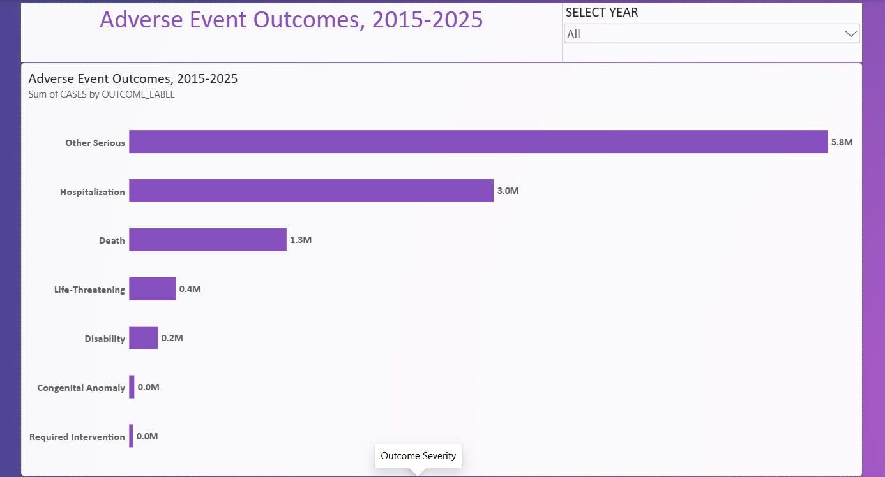
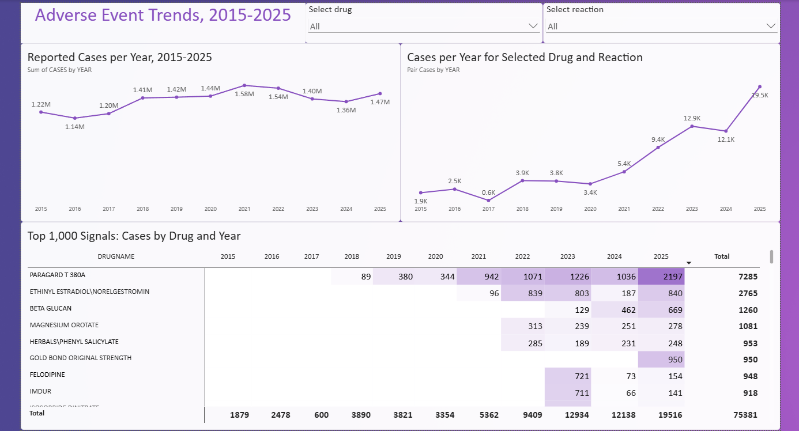

# FAERS Drug Safety Signal Dashboard (2015-2025)

An end-to-end pharmacovigilance analytics project. Ten years of raw FDA FAERS data
(44 quarters) are loaded into SQL Server, cleaned and deduplicated, scored for drug
safety signals (PRR/ROR), moved to Snowflake, and shown in an interactive Power BI dashboard.

**Scale:** 15,187,311 unique cases | 44 quarters (2015 Q1 - 2025 Q4) | 2,518,819 validated drug-reaction pairs

---

## Dashboard



The report has 5 pages: a one-screen **Dashboard** (KPI cards, outcome and sex donuts,
yearly trend, top signals), **Signal Overview**, **Age and Sex**, **Outcome Severity**
and **Trend**. A year slicer drives the cards and charts on the Dashboard page.

**Download the Power BI file:** `FAERS_Dashboard_10Y.pbix` is over 100 MB, so it is attached to the
[Releases page](../../releases) instead of the repository. Open it with Power BI Desktop; it is in
Import mode, so it works without a Snowflake connection.

### More pages

**Signal Overview**


**Age and Sex**


**Outcome Severity**


**Trend**


---

## Tech Stack

- **SQL Server**: loading, deduplication, cleaning, PRR/ROR calculation
- **Python** (pandas, pyarrow, sqlalchemy, snowflake-connector): Parquet export and Snowflake load
- **Snowflake**: cloud warehouse; summary tables built with SQL for the dashboard
- **Power BI**: Import-mode dashboard with DAX measures and a shared Years dimension table
- **Source data**: [FDA FAERS Quarterly Data Files](https://fis.fda.gov/extensions/FPD-QDE-FAERS/FPD-QDE-FAERS.html) (ASCII, 2015 Q1 - 2025 Q4)

## Pipeline

```
FDA ASCII files (44 quarters, ~15 GB)
        |  BULK INSERT (loop over quarters)
        v
SQL Server: staging -> raw -> dedup -> clean -> SIGNAL_SCORES (PRR/ROR)
        |  Python: export to Parquet (500K-row parts)
        v
Snowflake: PUT + COPY INTO -> summary tables (per year, per quarter, top pairs)
        |  Import mode
        v
Power BI dashboard (.pbix works offline after import)
```

---

## Repository Structure

```
faers-adverse-event-dashboard/
├── README.md
├── sql/
│   ├── faers_load_multi_year.sql       # schema + loop load of 44 quarters
│   ├── faers_clean_signals_10y.sql     # dedup, date/age cleaning, PRR/ROR, outcome labels
│   └── snowflake_summary_tables.sql    # summary tables used by Power BI
├── python/
│   ├── export_to_parquet_10y.py        # SQL Server -> Parquet
│   └── upload_to_snowflake.py          # Parquet -> Snowflake (PUT / COPY INTO)
└── screenshots/
```

---

## Methodology

### 1. Loading (2015 Q1 - 2025 Q4)
FAERS ships 7 `$`-delimited files per quarter (DEMO, DRUG, REAC, OUTC, THER, INDI, RPSR).
A loop loads each quarter into staging tables shaped exactly like the files, then copies them
into tagged raw tables. Older years needed wider columns (full country names, large ages),
and line endings differ between files and quarters, so every file is read with an LF
terminator and any stray carriage return is stripped.

### 2. Deduplication
FAERS reissues a case under a higher `caseversion` instead of overwriting it. Only the latest
version of each case is kept (with a tiebreaker on `primaryid` for rare ties), giving
**15,187,311 unique cases**.

### 3. Cleaning
- Text dates converted to real `DATE` columns
- Age normalized from mixed units (years, decades, months, weeks, days, hours) to `age_years`;
  implausible values (over 120) set to NULL
- Age bucketed into 0-17, 18-40, 41-65, 66+ and Unknown
- Outcome codes mapped to readable labels (Death, Hospitalization, and so on)

### 4. Signal detection (PRR / ROR)
For every drug-reaction pair a 2x2 table is built and **PRR** and **ROR** are calculated with a
**Haldane-Anscombe continuity correction**. Pairs need at least 3 cases (Evans criteria), and
three reliability filters remove unstable ratios caused by low drug volume, low reaction volume
or a near-zero comparison group. Result: **2,518,819 validated pairs**.

### 5. Warehouse and summary tables
Parquet exports are loaded to Snowflake with `PUT` and `COPY INTO` (row counts verified against
the source for all 5 tables). Small summary tables (cases per quarter, age and sex per year,
outcomes per year, top 1,000 pairs by year) keep the Power BI file small.

### 6. Power BI
- Import mode, so the `.pbix` keeps working without Snowflake
- A `Years` dimension table with one-to-many relationships to the summary tables, so one slicer
  filters several tables
- DAX measures: `Total Cases`, `Total Pairs`, `Strong Signals`, `Deaths`, `Death %`,
  `Pair Cases`, `YoY %`, `Avg ROR`
  (strong signal = at least 3 cases, PRR >= 2 and ROR >= 2)
- Conditional formatting (data bars on case counts, gradient on ROR), drop-down slicers,
  heatmap matrix, cross-filtering between visuals

---

## Key Findings

1. **Report volume grew about 20% over the decade**, from 1.22M cases in 2015 to 1.47M in 2025,
   peaking at 1.58M in 2021 and falling about 14% by 2024 before recovering.
2. **Serious outcomes peaked in 2020.** Hospitalization reports reached 312,668 and deaths
   141,991, the highest of any year. Deaths were about 9.9% of that year's reports, against
   8.6% in 2015 and 7.5% in 2025.
3. **8.6% of all cases include a death outcome** (1.30M of 15.19M); "Other Serious" is the
   largest outcome group at 53.5% of outcome records.
4. **Volume and statistical signal are different things.** HUMIRA / Drug ineffective has 66,861
   cases but an ROR of only 2.41, while OXYCONTIN / Drug dependence has 90,444 cases and an ROR
   of 619.79, and DUPIXENT / Dermatitis atopic has an ROR of 353.17.
5. **Women make up about 52% of reports and men 35%**; about 14% have no sex recorded.

---

## Data-Quality Notes

- About 40% of cases have no usable age (the `Unknown` group is the largest in the age chart)
- Some sex codes (`I`, `P`, `T`, `UNK`, blank) are rare or missing and are shown as reported
- Some drug names are raw free text (for example `*ASPIRIN`, `.ALPHA.-TOCOPHEROL`) and are not
  standardized, so the same drug can appear under several names
- A handful of DRUG rows per quarter are skipped because of embedded `$` delimiters in free text
  (negligible against tens of millions of rows)
- 2018 Q1 DEMO was loaded manually from `DEMO18Q1_new.txt`
- The Trend page's drug and heatmap visuals cover only the **top 1,000 signals** (at least 20
  cases, ranked by ROR), so they are not an overall trend; the yearly case chart covers all cases
- `SIGNAL_SCORES` is one score per pair across all years, so signal tables do not respond to
  the year slicer
- Outcome counts add up to more than total cases because one case can have several outcomes

## Limitations

FAERS is a spontaneous reporting system. Reports do not prove that a drug caused a reaction,
and the data has reporting bias, duplicate submissions and missing information. PRR/ROR show
statistical disproportionality, not confirmed safety signals. This is a standard caveat in real
pharmacovigilance work.

## Data Source

FDA FAERS Quarterly Data Files (ASCII), 2015 Q1 - 2025 Q4:
https://fis.fda.gov/extensions/FPD-QDE-FAERS/FPD-QDE-FAERS.html
